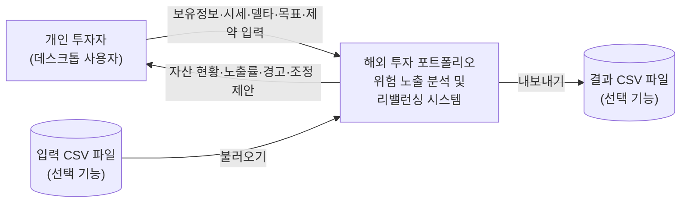

# 소프트웨어공학 과제 1 — 프로젝트 관리

**프로젝트명:** 파생상품을 고려한 해외 투자 포트폴리오 리밸런싱 시스템  
**영문명:** Derivatives-Aware Portfolio Rebalancing System  
**과제 목적:** 범위 정의(Scope Definition), 대상 시스템 및 이해관계자 분석, 제약사항 조사, 규모 산정, WBS 수립

> 본 문서는 프로젝트 착수 시점의 계획서이다. 개발 과정에서 요구사항·일정·구현 범위는 변경 관리 절차에 따라 수정할 수 있다.

## 1. 대상 제어기 선택

**선정 시스템:** 파생상품을 고려한 해외 투자 포트폴리오 리밸런싱 시스템

해외 주식·ETF·선물·옵션의 보유 포지션을 기록하고 시장 방향성 노출을 계산하여, 사용자 목표에 가까워지는 모의 매매 방안을 제안하는 **단일 사용자용 데스크톱 애플리케이션**이다.

### 1.1 선정 배경

일반적인 자산 관리 프로그램은 평가금액의 구성 비중에 초점을 맞춘다. 하지만 선물은 계약 명목금액, 옵션은 기초자산 가격 민감도(델타)에 의해 실제 평가금액과 다른 수준의 시장 노출이 발생할 수 있다. 본 프로젝트는 이러한 차이를 교육용 모형으로 보여 주는 것을 핵심 문제로 선택한다.

### 1.2 프로젝트 선정 근거

| 평가 항목 | 선정 근거 |
|---|---|
| 문제의 명확성 | 현재 노출과 목표 노출을 비교하고 정수 단위의 매매 제안을 산출하는 명확한 입출력 구조 |
| 개발 적합성 | PC 한 대에서 Python GUI·SQLite·입력 데이터만으로 구현 및 시연 가능 |
| 공학적 학습 | 요구사항 정의, 정보 모델, 계산 모듈, 제약조건 알고리즘, 단위·통합 시험 적용 가능 |
| 확장 가능성 | 기초 포트폴리오 → 파생상품 노출 분석 → 리밸런싱 추천의 순차 개발 가능 |

### 1.3 초기 가정 및 용어

| 항목 | 정의 |
|---|---|
| 개발 방식 | 개인 개발, 15주, 총 150시간(위험 대비 예비시간 포함)으로 가정 |
| 실행 환경 | 로컬 데스크톱 GUI / Python + PySide6 + SQLite / 인터넷 연결 필수 아님 |
| 지원 상품 | 미국 주식·ETF, 미국 주가지수 선물, 미국 주식·ETF의 콜·풋 옵션(사용자 수동 입력) |
| 노출 비중 | 계좌 순자산(NAV) 대비 델타 조정 시장 노출 비율. 100% 초과 또는 음수 가능 |
| 리밸런싱 | 목표 노출률과 현재 노출률 간 차이를 줄이는 매매 수량을 모의 계산하는 기능 |

**핵심 설계 원칙:** 단순 보유 자산 평가액(자산가치)과 주가 변동에 대한 민감도에 기반한 시장 노출(위험 노출 근사치)을 **서로 다른 지표**로 표시한다.

## 2. 프로젝트 범위 정의 (Project Scope Statement)

### 2.1 프로젝트 목표 (Objectives)

| ID | 검증 가능한 목표 |
|---|---|
| OBJ-01 | 주식·ETF·선물·옵션 포지션 및 가격·계약 정보를 등록·조회·수정·삭제할 수 있다. |
| OBJ-02 | 현재 계좌 순자산, 종목별 평가액, 상품별 시장 노출을 계산·표시한다. |
| OBJ-03 | 사용자 설정 목표 노출률과 실제 노출률의 차이를 상품군·기초자산군별로 표시한다. |
| OBJ-04 | 제약조건을 적용한 리밸런싱 제안을 생성하고 조정 전후 노출을 비교한다. |
| OBJ-05 | 최종 시연에서 정상 계산·오류 입력·제약 위반에 대한 테스트를 통과한다. |

### 2.2 범위 포함 사항 (In-Scope)

| 모듈 | 개발 및 제어 범위 |
|---|---|
| 포지션 관리 | 계좌 현금, 주식·ETF 수량, 선물 롱·숏 계약, 보유 콜·풋 옵션을 로컬에 저장 |
| 시세·상품 정보 | 현재 가격, 기초자산 가격, 계약 승수, 옵션 델타, 만기일을 사용자가 직접 입력 |
| 평가·노출 계산 | 순자산 및 평가손익, 주식 시가 노출·선물 명목 노출·옵션 델타 등가 노출 |
| 목표·제약 설정 | 기초자산군별 목표 순노출률, 허용 편차, 현금 잔액, 허용 총노출 상한 |
| 리밸런싱 | 주식·ETF 및 선물의 정수 매매 수량을 탐색해 목표 대비 편차 축소 제안 |
| UI·데이터 | 포지션 목록, 현재·목표·추천 후 비교 차트, SQLite 저장, CSV 입출력(확장) |

### 2.3 범위 제외 사항 (Out-of-Scope)

실제 증권사 계좌 로그인 및 주문 전송, 실시간 주가 API, 자동매매, 세금·거래 수수료의 정밀 계산, 금융기관 증거금·강제청산 검증, 옵션 이론가격 및 감마·베가·세타 기반 위험 모델, 다중 사용자 서버 기능은 제외한다.

기존 옵션 포지션은 위험 노출 계산에 포함하되, **신규 옵션 계약의 자동 매수·매도 추천은 확장 기능**으로 둔다.

### 2.4 주요 산출물 (Deliverables)

1. 프로젝트 관리 보고서
2. 요구사항 명세 및 UML 초안
3. GUI 실행 프로그램
4. SQLite 스키마 및 샘플 데이터
5. 단위·통합 시험 결과표
6. 사용자 실행·시연 안내서

### 2.5 수용 기준 (Acceptance Criteria)

| ID | 완료 판정 기준 |
|---|---|
| AC-01 | 입력·저장·재실행 후 읽기가 일관되게 동작한다. |
| AC-02 | 주식·선물·옵션 노출 계산의 사전 정의된 예제 테스트가 통과한다. |
| AC-03 | 목표 노출과 현재 노출의 차이를 수치 및 그래프로 확인할 수 있다. |
| AC-04 | 허용 조건 안에서만 매매를 제안하며, 불가능한 경우 사유를 표시한다. |

## 3. 시스템 문맥도 및 이해관계자 분석

문맥도(Context Diagram)는 시스템의 경계를 한 개의 처리 단위로 표현하고 외부 주체와 오가는 정보를 표시한다. **실제 증권사·거래소와의 연결은 본 프로젝트 범위에 없다.**

### 3.1 시스템 문맥도 (Context Diagram)

> **시스템 경계:** SQLite 데이터베이스와 계산 모듈은 시스템 내부 요소이므로 외부 주체로 표시하지 않았다. CSV 입출력은 선택·확장 사항이다.

### 3.2 외부 인터페이스 및 데이터 흐름

| 외부 요소 | 입력 → 시스템 | 시스템 → 외부 |
|---|---|---|
| 개인 투자자 | 포지션, 시세, 델타, 목표 노출, 제한조건 | 자산 현황, 노출률, 오류·경고, 리밸런싱 제안 |
| CSV 파일(선택) | 포지션·가격 데이터 일괄 불러오기 | 분석·추천 결과 내보내기 |

### 3.3 이해관계자 분석

| 이해관계자 | 관심·기대 | 핵심 요구 |
|---|---|---|
| 일반 사용자(주요) | 쉽고 정확한 모의 포트폴리오 분석 | 편한 입력, 명확한 설명, 계산 결과 시각화 |
| 개발자·유지보수자 | 기능 모듈화와 수정 용이성 | 계산 로직·GUI 분리, 오류 로그, 테스트 |
| 교수자·평가자 | 요구사항과 구현의 일관성 | 문서·시연·테스트의 추적 가능성 |

**주요 사용 시나리오:** 사용자 → 종목 및 파생상품 포지션 등록 → 현재 가격·델타 입력 → 노출 분석 → 목표 비중 지정 → 제한조건 설정 → 리밸런싱 제안 확인 → 시나리오 저장

## 4. 제약사항 조사

### 4.1 기술·운영·도메인 제약

| 구분 | 제약 및 영향 | 대응 방안 |
|---|---|---|
| 일정·인력 | 15주 개인 개발·총 150시간 가정 | 핵심 기능 선구현, 단계별 동결, 예비시간 확보 |
| 운영 환경 | 데스크톱 단독 실행, 외부 API 없이 시연 | 수동 가격 입력·SQLite 로컬 저장 |
| 가격 정합성 | 사용자 입력 가격과 델타의 기준 시점이 다를 수 있음 | 동일 스냅샷 가정, 입력 일시 표시 및 유효성 검증 |
| 선물 특성 | 계약 승수에 따라 작은 가격 움직임도 큰 노출 발생 | 선물별 계약 승수 필수 입력, 명목 노출 별도 표시 |
| 옵션 특성 | 델타는 기초자산 변화에 대한 국소적 근사이며 수시로 변화 | 고정 델타 스냅샷 분석으로 제한, 결과에 한계 표시 |
| 리밸런싱 | 정수 계약·현금 조건·총노출 제한 때문에 목표 정확히 달성 불가 가능 | 제약 기반 근사해 탐색, 편차와 미달성 사유 공개 |
| 보안·윤리 | 재무정보 로컬 저장, 실제 투자 판단과 오인 가능 | 가상 데이터 권장, 실거래·수익 보장 표현 배제 |

### 4.2 계산 모델에 관한 제약

| 상품·지표 | 교육용 시장 노출 근사식 |
|---|---|
| 주식·ETF | 현재 가격 × 보유 주수 (매수 포지션만 지원) |
| 주가지수 선물 | 선물 현재 가격 × 계약 승수 × 계약 수 (롱 + / 숏 -) |
| 주식·ETF 옵션 | 기초자산 가격 × 계약 승수 × 보유 계약 수 × 옵션 델타 |
| 자산군별 노출률 | 해당 군의 순 노출 합계 ÷ 계좌 순자산(NAV) × 100 |
| 총노출률 | 각 포지션 노출 절댓값의 합계 ÷ NAV × 100 |

순노출률은 100%를 초과하거나 음수가 될 수 있다. 기초자산군 간 상관관계, 옵션 감마, 거래 비용, 증거금 위험은 위 계산에 포함되지 않는다.

### 4.3 주요 위험 및 대응

| 위험 | 수준 | 완화 계획 |
|---|---|---|
| 파생상품 계산 오해·오차 | 높음 | 공식 자료 기반 공식을 명세하고 예제 테스트 고정 |
| 최적화 알고리즘 구현 지연 | 높음 | 탐욕적 근사 알고리즘부터 구현하고 정수·제약 검사 분리 |
| UI 개발 일정 초과 | 중간 | 핵심 3개 화면(입력·분석·추천)부터 완성 |
| 데이터 저장 오류 | 중간 | DB 트랜잭션·저장/재실행 통합 시험 |

## 5. 프로젝트 규모 산정

규모는 확정된 코드 줄 수(LOC)가 아니라 **기능 단위와 구현 공수**를 기반으로 산정한다. 외부 라이브러리 활용, 학습 시간 및 개발 경험에 따라 실제 공수는 변할 수 있으며 과제 시작 시점의 계획치로 취급한다.

### 5.1 기능 규모 추정

| 모듈 | 대표 세부 기능 | 기능 단위 수 |
|---|---|---:|
| 입력·저장 | 포지션 CRUD, 계좌·현금 관리, 가격·델타 입력, 로컬 저장 | 4 |
| 평가·노출 | 평가금액·손익, 선물 명목 노출, 옵션 델타 노출, 합산·그룹화 | 4 |
| 목표·제약 | 목표 노출 설정, 최대 노출·현금 조건 검증 | 2 |
| 리밸런싱 | 정수 수량 후보 생성, 편차 최소화 및 불가 사유 표시 | 2 |
| 시각화·시험 | 노출 비교 그래프, 입력 검증·테스트 데이터 | 2 |
| **합계** | **프로젝트 자체 기준의 기능 단위 집계 (표준 FP 산정 아님)** | **14** |

### 5.2 예상 개발 공수 (1인 기준)

| WBS 상위 코드 | 업무 영역 | 예상 시간 |
|---|---|---:|
| 1.0 | 프로젝트 관리·범위 정의 | 10 h |
| 2.0 | 요구사항 분석 및 설계 | 24 h |
| 3.0 | 기반 기능 및 데이터 관리 | 32 h |
| 4.0 | 위험 노출 분석 | 26 h |
| 5.0 | 리밸런싱 엔진 | 24 h |
| 6.0 | 시험·문서·시연 | 20 h |
| - | 예비시간(위험 대응) | 14 h |
| **합계** | **15주 × 주당 평균 10시간** | **150 h** |

- 기본 작업: **136시간**
- 예비시간: **14시간**
- 전체 계획: **150시간**

이는 주당 평균 10시간의 학습·개발 시간을 확보한다는 가정으로, 실무 생산성 추정치나 확정 납기가 아닌 **수업용 규모 산정**이다.

### 5.3 범위 조정 우선순위

| 구분 | 조정 방안 |
|---|---|
| 필수(MVP) | 주식·ETF 관리, 파생상품 노출 분석, 목표 설정, 근사 리밸런싱 제안 |
| 1차 축소 | CSV·부가 차트 보류 |
| 2차 축소 | 선물 매매 추천을 보류하고 주식·ETF만 추천 |
| 최소 보장 | 주식·ETF 비중 조정과 파생상품 보유·노출 분석은 별도로 제공 |

## 6. 주요 업무 구분 및 WBS 연계

WBS(Work Breakdown Structure)는 산출물 중심으로 분해했으며, 5단계의 작업시간과 동일한 상위 업무 코드를 사용한다.

### 6.1 작업 분해 구조 및 공수

| WBS | 세부 작업·산출물 | 공수(h) | 주차 |
|---|---|---:|---|
| **1.0** | **프로젝트 관리** | **10** | **1~2** |
| 1.1 | 주제·범위·가정 확정 | 3 | 1 |
| 1.2 | 요구사항 변경·리스크 관리 | 4 | 1~15 |
| 1.3 | 주간 진행 점검 | 3 | 1~15 |
| **2.0** | **요구사항 분석·설계** | **24** | **2~4** |
| 2.1 | 기능·비기능 요구사항 정의 | 8 | 2 |
| 2.2 | 문맥도·유스케이스·상태 분석 | 6 | 2~3 |
| 2.3 | DB·클래스·계산 로직 설계 | 6 | 3~4 |
| 2.4 | GUI 와이어프레임 | 4 | 4 |
| **3.0** | **기반 기능·데이터 관리** | **32** | **4~8** |
| 3.1 | 개발환경·프로젝트 뼈대 | 6 | 4 |
| 3.2 | 포지션 CRUD 및 SQLite | 16 | 5~7 |
| 3.3 | 평가금액·손익 계산 | 10 | 7~8 |
| **4.0** | **위험 노출 분석** | **26** | **8~11** |
| 4.1 | 선물·옵션 노출 계산 엔진 | 16 | 8~10 |
| 4.2 | 목표·현재 노출·그래프 | 10 | 10~11 |
| **5.0** | **리밸런싱 엔진** | **24** | **10~13** |
| 5.1 | 정수 근사 탐색 알고리즘 | 14 | 10~12 |
| 5.2 | 제약 검증 및 추천 UI | 10 | 12~13 |
| **6.0** | **시험·문서·시연** | **20** | **13~15** |
| 6.1 | 단위·경계값 테스트 | 10 | 13~14 |
| 6.2 | GUI·DB 통합 시험 | 6 | 14~15 |
| 6.3 | 최종 보고서·시연 준비 | 4 | 15 |
| **예비** | **문제 해결 예비 공수** | **14** | **유동** |

### 6.2 15주 마일스톤 계획

| 업무 | 1주 | 2주 | 3주 | 4주 | 5주 | 6주 | 7주 | 8주 | 9주 | 10주 | 11주 | 12주 | 13주 | 14주 | 15주 |
|---|:---:|:---:|:---:|:---:|:---:|:---:|:---:|:---:|:---:|:---:|:---:|:---:|:---:|:---:|:---:|
| 범위·계획 | ● | ● | | | | | | | | | | | | | |
| 요구사항·설계 | | ● | ● | ● | | | | | | | | | | | |
| 기반·데이터 | | | | ● | ● | ● | ● | ● | | | | | | | |
| 위험 노출 분석 | | | | | | | | ● | ● | ● | ● | | | | |
| 리밸런싱 | | | | | | | | | | ● | ● | ● | ● | | |
| 시험·제출 | | | | | | | | | | | | | ● | ● | ● |

> 단계별 일부 작업은 병행하며, 실제 강의 일정에 맞추어 변경할 수 있다. 범위·변경·리스크 관리 등 상시 활동은 상세 WBS의 기간을 따른다.

### 6.3 범위·요구사항과 WBS 연결

| 목표·수용기준 | 해당 기능 | 연계 WBS |
|---|---|---|
| OBJ-01 / AC-01 | 포지션 CRUD·DB 영속성 | 2.3 → 3.1~3.2 → 6.2 |
| OBJ-02 / AC-02 | 자산 평가·선물·옵션 노출 | 2.3 → 3.3 → 4.1 → 6.1 |
| OBJ-03 / AC-03 | 목표·현재 노출 비교 | 2.1 → 4.2 → 6.2 |
| OBJ-04 / AC-04 | 매매 후보·제약 검사·추천 | 2.3 → 5.1~5.2 → 6.1~6.2 |
| OBJ-05 | 시험 증거·사용설명서·시연 | 6.1~6.3 |

### 6.4 구현·시험의 대표 확인 사례

| ID | 테스트 입력·상황 | 기대 결과 |
|---|---|---|
| TC-01 | 주식 100주, 가격 $100 | 주식 시장 노출 +$10,000 |
| TC-02 | 선물 -2계약, 가격 3,000, 승수 5 | 선물 시장 노출 -$30,000 |
| TC-03 | 풋옵션 1계약, 기초 $100, 승수 100, 델타 -0.4 | 옵션 델타 조정 노출 -$4,000 |
| TC-04 | 순자산 0 이하 또는 계약 승수 누락 | 계산 중단 및 구체적 입력 오류 표시 |
| TC-05 | 현금·정수 수량·총노출 상한 동시 제약 | 제약 위반 제안 금지 또는 실행 불가 사유 표시 |

**완료 정의(Definition of Done):** 기능 구현과 화면 연동이 완료되고 예제 테스트 통과·계산 가정 설명·버전 관리 기록까지 확보되었을 때 해당 작업을 완료로 처리한다.

## 부록 A. 계산 정의 및 변경 관리

### A.1 계산에서 반드시 구분할 값

| 항목 | 초기 설계 규칙 |
|---|---|
| 계좌 순자산(NAV) | 현금 + 주식·ETF 시가 평가액 + 옵션 순평가액 + 선물 미실현손익(중복 계상 금지) |
| 시장 노출 | 주식 시가·선물 명목금액·옵션 델타 등가금액으로 만든 방향성 근사치 |
| 순노출 | 각 기초자산군에 속한 포지션의 부호 있는 시장 노출 합 |
| 총노출 | 포지션별 시장 노출 절댓값 합(포지션 간 상쇄 이전) |
| 목표 노출률 | 순노출 ÷ NAV × 100. 레버리지·헤지 때문에 합계 100% 조건을 강제하지 않음 |
| 추천 방식 | 제약을 만족하는 정수 수량 후보 중 목표와의 편차를 낮추는 근사해 탐색 |

### A.2 범위 변경 및 의사결정 원칙

핵심 변경 후보가 발생하면 다음 항목을 함께 기록한다.

1. 변경 사유
2. 수정 대상 요구사항(ID)
3. 일정·공수 영향
4. WBS 영향
5. 테스트 변경

필수 기능의 축소가 필요할 경우 새로운 범위·수용기준을 먼저 정한 뒤 문서와 구현을 동시에 갱신한다.

### A.3 참조 자료 (2026-10-29 확인)

1. U.S. SEC Investor.gov, [*Beginners’ Guide to Asset Allocation, Diversification, and Rebalancing*](https://www.investor.gov/additional-resources/general-resources/publications-research/info-sheets/beginners-guide-asset)
2. CME Group, [*About Contract Notional Value*](https://www.cmegroup.com/education/courses/introduction-to-futures/about-contract-notional-value)
3. Options Industry Council, [*Options Delta*](https://prd-web.optionseducation.org/advancedconcepts/delta)
4. The Options Clearing Corporation, [*Equity Options Product Specifications*](https://www.theocc.com/clearance-and-settlement/clearing/equity-options-product-specifications)

---
